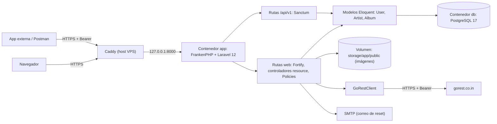

# 02. Technical Requirements Document (TRD)

> v1.1.0 (2026-10-23): corregido según `REVIEW_00-04.md` (A1, A3, A4, A5, A6, M1-M5, L4, L6). Secciones nuevas: §6 (configuración obligatoria) y §7 (entorno local).

Versiones consultadas en Packagist y Docker Hub el 2026-10-23. Laravel 13 ya es la versión actual (v13.38); la rúbrica exige **12**, así que se fija la rama 12.x, que sigue recibiendo parches (framework v12.70.1 del 2026-10-21).

## 1. Stack y Justificación

| Capa | Elección | Por qué | Descartado |
| :--- | :--- | :--- | :--- |
| Lenguaje | PHP 8.4 | Soportado por Laravel 12 (`^8.2`), mismo minor en local (8.4.27) y en el contenedor. | PHP 8.5: menos probado con paquetes de terceros a un mes de la entrega. |
| Framework | Laravel 12 (`composer create-project laravel/laravel:^12.0`) | Lo pide la rúbrica. `laravel new` instalaría la 13. | Laravel 13. |
| Autenticación web | Laravel Fortify 1.41 | Lógica de registro, login, logout, reset, perfil y contraseña sin vistas: las vistas son Blade propias. Trae rate limit de login. | Starter kits (React, Vue, Livewire): imponen UI y una SPA. Breeze: retirado en favor de los starter kits. |
| API y tokens | Laravel Sanctum 4.3 (`php artisan install:api`) | Tokens personales con hash en BD, middleware `auth:sanctum`, revocables. | Passport (OAuth2 completo): sobra para tokens personales. JWT a mano: inventar la rueda. |
| Base de datos | PostgreSQL 17 | Elegida por el usuario. Mismo motor y versión en local (contenedor `laravel-pg`) y en producción. | MySQL, SQL Server. |
| Vistas | Blade con dos layouts (`layouts.guest`, `layouts.app`) | La rúbrica pide herencia de maestras. | Inertia o Livewire. |
| CSS y JS | Vite + Tailwind CSS 4 (vienen en el esqueleto de Laravel 12) | Un solo pipeline de assets; la dirección visual la define la Etapa 4. | Bootstrap por CDN. |
| Tablas | DataTables 2 instalado por npm (`datatables.net-dt@^2.3`; el `latest` de npm ya es la 3.x) y empaquetado con Vite | Sale del mismo origen: funciona con `script-src 'self'` y no depende de un CDN el día de la sustentación. Corrección a la Etapa 0: DataTables 2 sigue trayendo jQuery como dependencia, aunque su API se usa sin jQuery (`new DataTable(...)`). | CDN (punto de falla externo y CSP abierta). `yajra/laravel-datatables`: purgatorio. |
| Gráficos | Chart.js 4 por npm | Igual que DataTables. Los datos llegan en un `<script type="application/json">` generado con `@json`, que no ejecuta código y no rompe la CSP. | ApexCharts (más pesado). |
| PDF | `barryvdh/laravel-dompdf` 3.1 | Renderiza una vista Blade. Las imágenes se pasan como ruta de disco, con `isRemoteEnabled=false`. | Browsershot (necesita Chrome en el contenedor). |
| Cliente REST externo | Cliente `Http` de Laravel contra GoRest | `withToken()`, `acceptJson()` y `timeout()` cubren tokens, cabeceras y autorización. | Guzzle directo: es lo mismo con más código. |
| Tests | PHPUnit 11 (default del esqueleto) con tests de feature y `RefreshDatabase` sobre una base `laravel_test` en el mismo PostgreSQL | Probar contra el motor real evita diferencias de SQLite (tipos, `ILIKE`, restricciones). | SQLite en memoria (rápido, pero otro motor). Pest: otra sintaxis que explicar en la sustentación. |
| Servidor en contenedor | FrankenPHP 1 sobre PHP 8.4 (`dunglas/frankenphp:1-php8.4`), modo clásico con `SERVER_NAME=:8000` (sin esa variable, su Caddyfile interno sirve HTTPS en :443) | Un solo proceso sirve HTTP en `:8000`; imagen multi-arquitectura (amd64 y arm64); `install-php-extensions` ya viene. | nginx + php-fpm: dos procesos y un supervisor. `php artisan serve`: es de desarrollo y atiende de a una petición. |

## 2. Arquitectura

- **Patrón**: monolito MVC de Laravel, sin capas extra. Controladores resource delgados, validación en `FormRequest`, autorización en Policies y un único servicio (`GoRestClient`) para la frontera externa.
- **Propiedad de los datos**: `artists.user_id`; el dueño de un álbum es el de su artista (`User::albums()` es `hasManyThrough`, ver 05 §1). Toda consulta parte de `$request->user()->artists()` o `->albums()`, y las Policies confirman la propiedad en `show`, `update` y `destroy` devolviendo `Response::denyAsNotFound()` si el registro es ajeno: la respuesta es 404, igual que si no existiera, en web y en API.
- **Concurrencia**: una instancia y tráfico de demostración. Sin colas: el correo de reset se envía en la misma petición (`QUEUE_CONNECTION=sync`).

## 3. Requisitos No Funcionales

- **Rendimiento**: páginas del dashboard con menos de 300 ms de servidor (p95) y PDF en menos de 3 s, con los datos del seeder. Listados con carga anticipada (`with('artist')`) para evitar N+1.
- **Peso de JS**: DataTables y Chart.js son entradas de Vite separadas y se cargan solo en las vistas que las usan. Landing y formularios sin JS de librerías.
- **Seguridad**:
  - CSRF en todos los formularios (default de Laravel); cookies `HttpOnly`, `Secure` (`SESSION_SECURE_COOKIE=true`) y `SameSite=Lax`.
  - Rate limits: login de Fortify en 5 por minuto por correo e IP; `POST /api/v1/tokens` en 5 por minuto; resto de la API en 60 por minuto por usuario autenticado; `POST /forgot-password` en 6 por minuto por IP (Fortify no le pone límite: se agrega `throttle:6,1` a esa ruta).
  - `trustProxies(at: '*')` es seguro solo porque el puerto de la app se publica en `127.0.0.1` y únicamente Caddy le habla. Si el puerto se abre a internet, deja de serlo.
  - Cabeceras desde un middleware propio, solo en producción: `Content-Security-Policy` (`default-src 'self'`, `script-src 'self'`, `img-src 'self' data:`, `frame-ancestors 'none'`), `X-Content-Type-Options: nosniff`, `Referrer-Policy: strict-origin-when-cross-origin`. Caddy no agrega CSP (regla de la VPS).
  - "Olvidé mi contraseña" no revela correos: Fortify por defecto responde "We can't find a user with that email address". Se registra un `FailedPasswordResetLinkRequestResponse` propio que, para `INVALID_USER` y `RESET_THROTTLED`, responde lo mismo que el éxito: "Si el correo existe, te enviamos un enlace".
  - Subidas: `mimes:jpg,jpeg,png,webp` y `max:2048`, nombre aleatorio que genera Laravel, guardadas en el disco `public`. Nunca se usa el nombre original como ruta.
  - Secretos (`APP_KEY`, clave de BD, token de GoRest, SMTP) solo en `.env` (600 en la VPS); el repo lleva `.env.example` sin valores.
- **Tolerancia a fallos (fail-fast)**:
  - Crear o editar con imagen, en este orden:
    1. Validación.
    2. Se guarda el archivo nuevo **antes** de abrir la transacción. El disco `public` lleva `'throw' => true` en `config/filesystems.php` (el default de Laravel 12 es `false`: `store()` devolvería `false` en silencio y la fila quedaría con una imagen rota). Si falla, la excepción corta la petición y no se escribe nada.
    3. Escritura de la fila dentro de `DB::transaction`. Si la transacción falla, se borra el archivo nuevo y se relanza la excepción.
    4. La imagen vieja se borra con `DB::afterCommit`, para que un rollback no deje la fila apuntando a un archivo borrado.
  - Borrar un artista: sus álbumes caen por `ON DELETE CASCADE`, y los archivos se borran después del commit.
  - GoRest: `connectTimeout(3)->timeout(6)`. Los `GET` reintentan 1 vez a los 200 ms, solo ante `ConnectionException`; `POST`, `PUT` y `DELETE` no se reintentan. El peor caso queda por debajo de 15 s, lejos del `max_execution_time` de 30 s. Los errores se clasifican por código de estado, nunca por el texto del cuerpo (GoRest devuelve textos distintos para el mismo 401). Un error se muestra tal cual con botón "Reintentar"; nunca hay datos de relleno.
  - Correo de reset: si el SMTP falla, la petición devuelve error 500 y queda en el log; no se finge el envío.
- **Plataformas**: desarrollo en Windows 11 (PHP 8.4.27 oficial, PostgreSQL en Docker); producción en Linux, primero x86_64 y después ARM64.

## 4. Despliegue (VPS Oracle, según "Infraestructura" de `~/.claude/CLAUDE.md`)

- **URL**: `https://laravel.helx.page`. El DNS comodín ya apunta a la VPS (verificado: resuelve a 157.137.195.173).
- **Carpetas**: clon en `~/apps/laravel`; `compose.yml` y `.env` (600) en `~/apps/laravel-deploy/`, fuera del repo. El `Dockerfile` va **en el repo** (regla actual de la VPS).
- **Dockerfile** (multi-etapa):
  - Etapa `assets`: `node:22-alpine` corre `npm ci && npm run build`.
  - Etapa final: `dunglas/frankenphp:1-php8.4` con `install-php-extensions pdo_pgsql gd intl zip opcache` y `composer install --no-dev --optimize-autoloader`.
  - `conf.d/uploads.ini` propio: `upload_max_filesize=4M`, `post_max_size=8M`. Sin él, PHP usa 2M y un archivo de 2 a 8 MB falla con un error genérico en vez del mensaje de 2 MB.
  - `php artisan storage:link` en el build (sin el symlink `public/storage`, todas las imágenes dan 404).
  - `chown -R 1001:1001 storage bootstrap/cache` antes de declarar los volúmenes, para que el usuario 1001 pueda escribir.
  - `ENV SERVER_NAME=:8000`.
- **compose.yml**: dos servicios, con la plantilla de endurecimiento de la VPS adaptada a lo que Laravel necesita escribir:
  - `app`: `user: "1001:1001"`, `read_only: true`, `cap_drop: [ALL]`, `security_opt: [no-new-privileges:true]`, `mem_limit: 512m`. Publica `127.0.0.1:8000:8000`.
    - Volumen `laravel-storage` en `/app/storage/app/public` (imágenes).
    - `tmpfs` para `/tmp`, `/app/storage/framework` (vistas compiladas y caché; las sesiones van en la BD), `/app/storage/logs`, `/app/bootstrap/cache`, `/app/storage/fonts` (caché de fuentes de dompdf), y `/data` y `/config` (el Caddy interno de FrankenPHP). Lo que vive en `tmpfs` se regenera al arrancar.
    - Healthcheck de Docker sobre `/up`.
  - `db`: `postgres:17-alpine` sin puerto publicado, volumen `laravel-pgdata`, `mem_limit: 256m`.
- **Caddy**: se agrega `laravel.helx.page { reverse_proxy localhost:8000 }` sin tocar los demás bloques; después `sudo caddy validate --config /etc/caddy/Caddyfile --adapter caddyfile && sudo systemctl reload caddy`.
- **Laravel detrás del proxy**: `$middleware->trustProxies(at: '*')` en `bootstrap/app.php`, `APP_URL=https://laravel.helx.page`, `SESSION_SECURE_COOKIE=true`, `APP_ENV=production`, `APP_DEBUG=false`.
- **Redesplegar**: `git pull` → `docker compose build` → `docker compose run --rm app php artisan migrate --force` → `docker compose up -d`. El contenedor corre `php artisan optimize` al arrancar (cachea config, rutas y vistas en los `tmpfs`).
- **Prueba de humo después de cada deploy**: `curl -fsS https://laravel.helx.page/up`, subir una imagen, verla en la lista y descargar un PDF. Es una compuerta del GATES.
- **Migración a ARM (A1)**: la imagen se construye en el propio host y todas las bases (`node`, `frankenphp`, `postgres`) publican arm64, así que el código no cambia. Los datos se mueven con `pg_dump -Fc` / `pg_restore` más una copia del volumen `laravel-storage`.
- **Respaldo**: cron diario en el host con `pg_dump -Fc` y un `tar` del volumen de imágenes en `~/backups/laravel`, guardando los últimos 7 días. RPO de 24 h. Se mantiene porque protege los datos de demostración durante la migración de VM. La copia fuera del servidor queda en el purgatorio.
- **Registro**: al publicar, se agrega la app a "Apps desplegadas" y el puerto 8000 a "Puertos tomados" en `~/.claude/CLAUDE.md`.

## 5. Calendario y Riesgos

El riesgo mayor (despliegue más correo) va primero, no al final.

| Fecha | Hito |
| :--- | :--- |
| 2026-10-24 | Etapa 4 aprobada; Etapa 5 corta (esquema de 3 tablas) y GATES. Repo creado. |
| **2026-10-30** | **Esqueleto publicado**: Laravel 12 + Fortify con vistas mínimas en `https://laravel.helx.page`, en el host que va a existir el 2026-11-21, con un correo de reset real llegando por Resend. Si a esa fecha A1 no tiene capacidad o el upgrade a Pay As You Go no está resuelto, se activa el plan B. |
| 2026-11-08 | CRUD x2 con imágenes, DataTables, PDF, gráfico, API y GoRest funcionando en producción. |
| 2026-11-14 | Funcionalidad congelada. Solo arreglos. |
| 2026-11-18 | Ensayo completo de la sustentación sobre producción, cada integrante con sus historias. |

| Riesgo | Mitigación |
| :--- | :--- |
| La VM Intel del trial vence hacia el 2026-11-20, un día antes de la sustentación, y la capacidad de A1 no está garantizada. | Resolver el host antes del 2026-10-30. Plan B: VPS genérico de unos 5 USD al mes con Docker; el despliegue es el mismo `git clone` + `.env` + `docker compose up` + restaurar el respaldo. |
| GoRest caído o lento el día de la sustentación. | Timeouts cortos, error honesto y video grabado del flujo como respaldo. Los tests usan `Http::fake()`, así que no dependen de GoRest. GoRest resiembra sus datos a diario: el guion crea, edita y borra en el momento, sin depender de filas de días anteriores. |
| Resend sin dominio verificado: solo entrega a la cuenta dueña. | Registros DNS de Resend para `helx.page` en el registrador antes del 2026-10-30 (de paso destraba el correo del Portfolio). SMTP: `smtp.resend.com`, puerto 587 (STARTTLS) o 465, usuario `resend`, clave = API key. No usar el 25 (Oracle suele bloquear la salida por ese puerto; no verificado). En local, `MAIL_MAILER=log`. |
| Un integrante no logra levantar el proyecto. | Camino único de instalación en el README (§7) y prueba de instalación en la máquina de cada integrante la primera semana. |
| Composer resuelve Laravel 13 por error. | `composer.json` fija `laravel/framework: ^12.0`; una compuerta del GATES verifica `php artisan --version` = 12.x. |

## 6. Configuración Obligatoria (sobre el esqueleto de Laravel 12)

Lo que el esqueleto trae por defecto y hay que cambiar. Cada línea tiene su test o compuerta en el GATES.

- `config/fortify.php`: `'home' => '/dashboard'` (el default `/home` da 404 después del login). `features` solo con `registration()`, `resetPasswords()`, `updateProfileInformation()` y `updatePasswords()`: fuera `twoFactorAuthentication` y `passkeys`, que vienen activas y piden `laravel/passkeys`. No se corre la migración de columnas de 2FA.
- `config/filesystems.php`: `'throw' => true` en el disco `public`.
- Idioma: `APP_LOCALE=es`, `APP_FALLBACK_LOCALE=es`, `php artisan lang:publish` y los archivos `lang/es/{validation,auth,passwords,pagination}.php` (con `laravel-lang/common` como dependencia de desarrollo o a mano). Un test afirma un mensaje de validación en español.
- `phpunit.xml`: `DB_CONNECTION=pgsql`, `DB_DATABASE=laravel_test` (el esqueleto trae SQLite en memoria, y el PHP de Windows no tiene `pdo_sqlite`).
- `.env.example`: `DB_CONNECTION=pgsql` con los valores del contenedor local, `QUEUE_CONNECTION=sync`, `SESSION_DRIVER=database`, `GOREST_TOKEN=` vacío.
- Vistas de error propias: 403, 404, 413 (archivo mayor al `post_max_size`), 419 y 500. 429 y 503 quedan con las de Laravel.

## 7. Entorno Local (camino único para los tres integrantes; va al README)

1. PHP 8.4 NTS x64 oficial: el zip de `windows.php.net/downloads/releases/`, descomprimido en `%USERPROFILE%\.config\php-8.4`, con esa carpeta primero en el PATH de usuario.
2. `php.ini` copiado de `php.ini-development`, con `extension_dir = "ext"` y estas extensiones activas: `curl`, `fileinfo` (obligatoria para la regla `mimes:`), `gd`, `intl`, `mbstring`, `openssl`, `pdo_pgsql`, `pgsql`, `sodium`, `zip`. Además `upload_max_filesize = 4M`, `post_max_size = 8M` y `memory_limit = 512M`, iguales a producción.
3. Composer 2.
4. Docker Desktop y el PostgreSQL: `docker run -d --name laravel-pg --restart unless-stopped -e POSTGRES_DB=laravel -e POSTGRES_USER=laravel -e POSTGRES_PASSWORD=laravel_dev_local -p 127.0.0.1:5432:5432 -v laravel-pgdata:/var/lib/postgresql/data postgres:17-alpine`, y después `docker exec laravel-pg psql -U laravel -d postgres -c "CREATE DATABASE laravel_test"`.
5. Node 22 o superior, para Vite.
6. `composer install`, `npm ci`, copiar `.env.example` a `.env`, `php artisan key:generate`, `php artisan migrate --seed`, `php artisan storage:link`, `composer run dev`.

En la máquina del usuario ya está todo hecho, incluida la base `laravel_test` (creada el 2026-10-23). Límites de subida igualados a producción (4M y 8M) el mismo día.

## 8. Supuestos a Validar

1. **Proveedor de correo** (DECIDIDO 2026-10-23: Resend con `helx.page`). Faltan los registros DNS en el registrador.
2. **Token de GoRest**: alguien del equipo tiene que crear una cuenta en gorest.co.in (entra con GitHub o Google) y copiar su token al `.env`. No se puede automatizar.
3. **Repositorio**: se crea al empezar el código, en la cuenta `TicoraX` y público para que el docente lo vea, con los otros dos integrantes como colaboradores. Falta el nombre del repo.
4. **Etapa 5 corta**: el esquema son 3 tablas propias (`users`, `artists`, `albums`) más `personal_access_tokens` de Sanctum. El documento de la Etapa 5 se reduce a columnas, índices, llaves foráneas y reglas de validación; las migraciones son la fuente de verdad.
