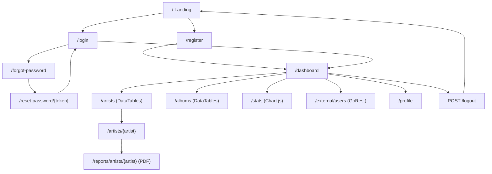
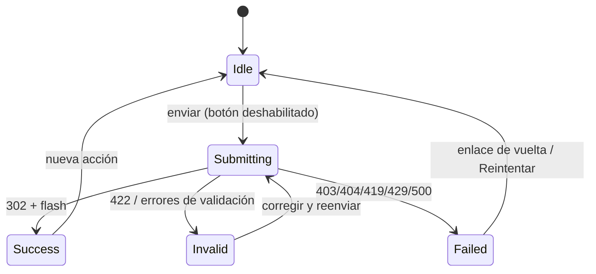

# 03. App Flow y Estados de Pantalla

> v1.1.0 (2026-10-23): corregido según `REVIEW_00-04.md` (B1, A1, M1, M7, L2, L3, L6 y recortes).
>
> v1.2.0 (2026-10-24): corregido según `REVIEW_05-06.md` (A2, A3, A5, M2, M10, M13, B3, B9).

App renderizada en el servidor (Blade). Casi todos los estados salen de una petición HTTP completa: el "loading" es el envío del formulario y el "success" es la redirección con un mensaje flash. Solo DataTables, Chart.js y el cuadro de confirmación de borrado usan JS, Sin JS no se rompe nada esencial (la tabla queda como tabla HTML y el formulario de borrado se envía directo), pero no se construye ninguna ruta ni vista extra para ese caso.

## 1. Navegación y Rutas

### Rutas web

| Ruta | Método | Propósito | Guarda |
| :--- | :--- | :--- | :--- |
| `/` | GET | Landing (`Route::view`, sin closure, por convención) | Pública. Con sesión iniciada, el CTA cambia a "Ir al dashboard". |
| `/register` | GET, POST | Registro (Fortify) | `guest` |
| `/login` | GET, POST | Login (Fortify) | `guest`, `throttle:login` (5/min por correo e IP) |
| `/forgot-password` | GET, POST | Pedir enlace de reset | `guest`; el POST con `throttle:6,1` agregado solo a la ruta `password.email` (Fortify no lo trae; mecanismo en 02 §3) y respuesta idéntica exista o no el correo |
| `/reset-password/{token}` | GET | Formulario de contraseña nueva | `guest`, token de un solo uso (guardado con hash) que vence a los 15 min |
| `/reset-password` | POST | Guardar contraseña nueva | `guest` |
| `/logout` | POST | Cerrar sesión e invalidarla | `auth` |
| `/dashboard` | GET | Inicio: usuario activo, menú y conteos | `auth` |
| `/artists` | resource (7 rutas, parámetro `{artist}`) | CRUD de artistas | `auth` + binding con alcance de usuario + `ArtistPolicy` |
| `/albums` | resource (7 rutas, parámetro `{album}`) | CRUD de álbumes | `auth` + binding con alcance de usuario + `AlbumPolicy` |
| `/reports/artists/{artist}` | GET | Ficha PDF de un artista (la ruta usa `reports` por convención técnica) | `auth` + binding con alcance de usuario + `ArtistPolicy@view` |
| `/stats` | GET | Gráficos | `auth` |
| `/external/users` | GET, POST | Listar y crear en GoRest | `auth` |
| `/external/users/create` | GET | Formulario de alta | `auth` |
| `/external/users/{id}/edit` | GET | Formulario de edición (lee de GoRest) | `auth` |
| `/external/users/{id}` | PUT, DELETE | Editar y borrar en GoRest | `auth` |
| `/profile` | GET | Editar perfil, contraseña y tokens | `auth` |
| `/user/profile-information` | PUT | Nombre, correo y foto (Fortify) | `auth` |
| `/user/password` | PUT | Cambiar contraseña pidiendo la actual (Fortify) | `auth` |
| `/profile/tokens` | POST | Crear un token de API desde la UI | `auth` |
| `/profile/tokens/{token}` | DELETE | Revocar un token propio | `auth`; solo tokens del usuario |
| `/up` | GET | Salud del proceso (Laravel 12) | Pública, sin datos |

### Rutas API (`/api/v1`, siempre JSON)

| Ruta | Método | Respuesta OK | Guarda |
| :--- | :--- | :--- | :--- |
| `/tokens` | POST `{email, password, device_name}` | 201 `{token}` | `throttle:5,1`. Credenciales malas: 422 con mensaje genérico. |
| `/artists` | GET | 200 lista paginada (15 por página) | `auth:sanctum`, `throttle:60,1` (por usuario) |
| `/artists` | POST | 201 + `Location` | `auth:sanctum` |
| `/artists/{artist}` | GET | 200 | `auth:sanctum` + binding con alcance de usuario + Policy |
| `/artists/{artist}` | PUT | 200 | `auth:sanctum` + binding con alcance de usuario + Policy |
| `/artists/{artist}` | DELETE | 204 | `auth:sanctum` + binding con alcance de usuario + Policy |

Errores de la API: 401 sin token o con token inválido o vencido, 404 para un artista que no existe o que es de otro usuario, 422 con `errors` por campo, 429 con `Retry-After`. El ajeno y el inexistente devuelven el mismo cuerpo (`{"message": "No encontrado"}`): el `Route::bind` resuelve `{artist}` desde los artistas del usuario antes de validar, así que un `PUT` ajeno con datos inválidos también da 404 y no 422 (05 §2, I2; lo mismo en las rutas web). Nunca HTML ni redirección al login, aunque la petición no mande `Accept: application/json`: `bootstrap/app.php` fuerza JSON en `api/*` (02 §6).

## 2. Estados por Pantalla

Convenciones para todas las vistas:
- **Loading** en formularios: al enviar, el botón principal queda deshabilitado con el texto "Guardando…" (un listener del `app.js` sobre `form[data-submit-once]`). Esto evita el doble envío.
- **Success**: redirección y mensaje flash (`session('status')`) arriba del contenido, que se puede cerrar y anuncia `role="status"`.
- **Error de validación**: el formulario vuelve con `old()` y el error debajo de cada campo (`aria-describedby`). Arriba va un resumen con el número de errores.
- **Errores HTTP**: páginas propias en `resources/views/errors/` (403, 404, 413, 419, 500; 429 y 503 quedan con las de Laravel) que heredan la maestra y llevan un enlace de vuelta. Nunca la pantalla de depuración en producción.

### Landing `/`
1. **Idle**: qué es Discoteca, un CTA primario "Crear cuenta" y uno secundario "Iniciar sesión".
2. **Loading**: no aplica (página estática).
3. **Empty**: no aplica. Sin cifras ni testimonios inventados.
4. **Error**: 500 propio.
5. **Success**: con sesión iniciada, el CTA lleva al dashboard.

### Registro, Login, Olvidé y Reset
1. **Idle**: formulario con `<label>` visible en cada campo y enlaces cruzados (login ↔ registro, login → olvidé).
2. **Loading**: botón deshabilitado al enviar.
3. **Empty**: no aplica.
4. **Error**: credenciales inválidas con un mensaje genérico; bloqueo por throttle con "Demasiados intentos, espera N segundos"; token de reset vencido o inválido con un enlace para pedir otro. Si falla el envío del correo, sale el error 500 (no se finge el envío).
5. **Success**: el registro y el login llevan al dashboard. "Olvidé" muestra "Si el correo existe, te enviamos un enlace" (el mismo texto exista o no el correo). El reset lleva al login con el flash "Contraseña actualizada".

### Dashboard `/dashboard`
1. **Idle**: saludo con el nombre, avatar (foto o iniciales), menú lateral (Inicio, Artistas, Álbumes, Estadísticas, API externa, Mi perfil, Cerrar sesión) y conteos reales de artistas y álbumes con accesos directos.
2. **Loading**: no aplica (render en el servidor).
3. **Empty**: con 0 artistas, "Todavía no tienes artistas" y un CTA "Crear tu primer artista" en lugar de los conteos.
4. **Error**: 500 propio.
5. **Success**: flash de la acción anterior si la hubo (por ejemplo, después del registro).

### Listas `/artists` y `/albums`
1. **Idle**: tabla DataTables en español con búsqueda, orden y 10 filas por página. Artistas: foto, nombre, país, género, cantidad de álbumes y acciones. Álbumes: portada, título, artista, año, género y acciones. Botón "Nuevo".
2. **Loading**: la tabla llega completa desde el servidor y DataTables la mejora al cargar. Sin skeleton: no hay espera de red después del render.
3. **Empty**: sin registros, en lugar de la tabla va un bloque vacío con un CTA "Crear el primero". En álbumes, si no hay artistas, el CTA lleva a crear un artista primero.
4. **Error**: 500 propio. Si el JS no carga, queda la tabla HTML sin búsqueda pero completa.
5. **Success**: flash "Artista creado", "Artista actualizado" o "Artista eliminado".

### Formularios de artista y álbum (create / edit)
1. **Idle**: campos con label; la imagen muestra una vista previa de la actual en edición y el aviso "JPG, PNG o WebP, hasta 2 MB". En álbumes, el selector lista solo los artistas del usuario.
2. **Loading**: botón deshabilitado al enviar (la subida puede tardar).
3. **Empty**: en álbumes sin artistas, el formulario no se muestra; va el CTA hacia crear un artista.
4. **Error**: validación por campo; imagen inválida o pesada con el error junto al campo; un `artist_id` ajeno da error de validación ("El artista seleccionado no es válido").
5. **Success**: redirección a la vista de detalle (`show`) con flash.

### Detalle del artista `/artists/{artist}`
1. **Idle**: foto, datos, lista de álbumes y los botones Editar, Eliminar y "Descargar PDF".
2. **Loading**: la descarga del PDF es una navegación normal; el navegador muestra el progreso.
3. **Empty**: sin álbumes, "Este artista todavía no tiene álbumes" y el CTA "Agregar álbum" con el artista preseleccionado.
4. **Error**: artista ajeno o inexistente da 404 propio.
5. **Success**: la ficha PDF se descarga como `artista-<slug>.pdf`.

### Confirmación de borrado
1. **Idle**: un `<dialog>` nativo con "Vas a eliminar a X y sus N álbumes. No se puede deshacer." y los botones Cancelar (con el foco inicial) y Eliminar. Sin JS, el formulario DELETE se envía directo.
2. **Loading**: botón Eliminar deshabilitado al enviar.
3. **Empty**: no aplica.
4. **Error**: si el borrado falla, se hace rollback, sale el error 500 y el registro sigue ahí.
5. **Success**: vuelve a la lista con el flash "Artista eliminado".

### Estadísticas `/stats`
1. **Idle**: un gráfico de barras de álbumes por género, con su título y una tabla de datos debajo (accesible para lectores de pantalla).
2. **Loading**: los datos llegan embebidos en un `<script type="application/json">`; no hay petición extra.
3. **Empty**: con 0 álbumes, "Agrega álbumes para ver tus estadísticas" y un CTA, en lugar de los gráficos.
4. **Error**: si Chart.js no carga, la tabla de datos sigue visible. Los colores del gráfico salen de variables en `:root` (Tailwind 4 no emite las de `@theme` que ninguna clase usa).
5. **Success**: no aplica (vista de lectura).

### API externa `/external/users` (GoRest)
1. **Idle**: los usuarios externos creados desde la app, es decir con correo `@discoteca.test` (`GET /public/v2/users?email=discoteca.test&per_page=100`; sin `per_page` GoRest devuelve 10 y, tras muchas demos, los más viejos quedan fuera), con nombre, correo, género y estado, los botones Editar y Eliminar, y "Nuevo usuario". GoRest solo deja modificar filas creadas con el mismo token, por eso no se listan las ajenas. Un recuadro técnico muestra el método, la URL y las cabeceras de la última llamada, con el token enmascarado (`Bearer abcd…wxyz`), para explicarlo en la sustentación.
2. **Loading**: la página espera la respuesta de GoRest en el servidor (3 s de conexión y 6 s de respuesta por intento); los formularios deshabilitan el botón al enviar.
3. **Empty**: si no hay usuarios `@discoteca.test` (GoRest resiembra sus datos a diario), "Todavía no creaste usuarios externos" y el CTA "Crear uno".
4. **Error**:
   - Timeout o error de conexión: "No pudimos contactar a GoRest (motivo)" y botón "Reintentar".
   - 401: "El token de GoRest no es válido o no está configurado". Se decide por el código de estado, no por el texto (GoRest responde "Authentication failed" sin token e "Invalid token" con uno inválido).
   - 403: "Ese usuario lo creó otra cuenta de GoRest; solo puedes editar los que creaste aquí".
   - 422: los errores que devuelve GoRest (`[{field, message}]`) se muestran junto a cada campo.
   - 404 al editar o borrar: "Ese usuario ya no existe en GoRest" (otra persona pudo borrarlo: la API es pública y compartida).
   - 429: el mensaje de límite de GoRest.
5. **Success**: flash "Usuario creado en GoRest (id N)", "actualizado" o "eliminado", y la lista se recarga desde GoRest.

### Perfil `/profile`
1. **Idle**: tres bloques. Datos (nombre, correo y foto con vista previa), contraseña (actual, nueva y confirmación) y tokens de API (lista con nombre y fecha de creación, más el botón Revocar, y un formulario para crear uno nuevo).
2. **Loading**: botón deshabilitado por formulario.
3. **Empty**: sin tokens, "No tienes tokens de API" y una explicación de una línea de para qué sirven.
4. **Error**: correo ya usado, contraseña actual incorrecta o foto inválida, cada uno junto a su campo. Fortify usa *error bags* separados por formulario, así que los errores de un bloque no aparecen en otro.
5. **Success**: flash por bloque. Al crear un token, el valor en claro se muestra **una sola vez** con un botón Copiar y el aviso de que no se podrá ver de nuevo.

## 3. Máquina de Estados (formularios con mutación)

## 4. Casos de Borde y Recuperación

- **Sesión vencida o token CSRF viejo (419)**: página propia "Tu sesión expiró. Vuelve a cargar la página y repite la acción" con enlace al login. No se pierde nada guardado, porque la mutación no se ejecutó.
- **Atrás después de logout**: las páginas autenticadas responden `Cache-Control: no-store` (middleware `cache.headers:no_store;private` en el grupo `auth`, 02 §6), así que el navegador no muestra el dashboard desde su caché.
- **Doble envío**: el botón se deshabilita; además, crear un registro redirige (POST-redirect-GET), de modo que recargar no lo duplica.
- **Borrar con archivos**: los archivos se borran después del commit. Si el commit falla, los archivos siguen ahí y la fila también.
- **Imagen huérfana al editar**: la imagen vieja se borra solo si la nueva quedó guardada y la fila confirmada.
- **GoRest responde algo inesperado** (sin `id`, campos faltantes): el cliente valida la forma de la respuesta y la trata como error ("Respuesta inesperada de GoRest"), no la pinta a medias.
- **Correo cambiado en el perfil**: la sesión sigue activa y el próximo reset de contraseña va al correo nuevo. No se reenvía verificación (fuera de alcance).
- **Token de API revocado mientras una app externa lo usa**: la siguiente petición recibe 401 de inmediato (Sanctum lo busca en la BD en cada petición).
- **Usuario borrado manualmente en la BD**: sus artistas y álbumes caen en cascada; sus tokens y sesiones quedan huérfanos y no autentican (05 §2, I5). La app no ofrece borrar cuentas.

## 5. Supuestos a Validar

1. **Tokens de API también desde la UI** (`/profile`), además de `POST /api/v1/tokens`. En la sustentación es más claro crear el token en pantalla y pegarlo en Postman que explicar un login por API. Las dos vías quedan.
2. **El recuadro técnico en la pantalla de GoRest** (método, URL, cabeceras con el token enmascarado) sirve para mostrar en vivo "tokens, cabeceras y autorización" sin abrir el código. Es la única pieza de la UI pensada para la sustentación y no para un usuario real.
